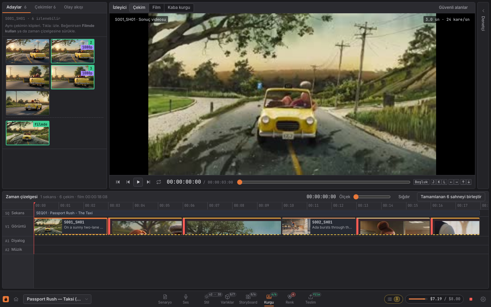

# Hell Grind — Otonom AI Animasyon Fabrikası

Senaryodan film üreten otonom bir animasyon hattı. Bu aşamada hattın **tamamı yerel ve ücretsiz** bileşenlerle çalışır: hiçbir ücretli servis çağrılmaz, hiçbir kredi kartı gerekmez. Üretim, bir kontrol paneliyle izlenir ve yönetilir. Uzun vadeli hedef 90 dakikalık bir filmdir.



## Neler yapar

1. **Senaryoyu okur.** Standart senaryo biçimini (sahne başlığı, konuşan karakter, aksiyon) kural tabanlı ayrıştırıcıyla çekimlere böler. Her çekim için kamera, duygu, süre ve aksiyon yoğunluğu çıkarır.
2. **Eksik referansla üretmez.** Model eksik bilgiyi uydurur: çekimde geçen her karakter, mekân ve nesnenin onaylı ve kilitli bir referansı yoksa o çekim *engellenir* ve hiçbir şey harcanmaz. Referanslar *Varlıklar* sayfasında yüklenir, kısa bir hareket testinden geçer ve yönetmen onayıyla kilitlenir.
3. **Tek bir stil dili kullanır.** Işık dili, hareket tarzı ve render kuralları projenin sürümlü *stil kılavuzundan* gelir ve her çekimin prompt'una aynı ifadeyle eklenir. Kılavuz değişince önce hangi çekimlerin yeniden üretileceği ve kaça mal olacağı gösterilir; yönetmen onaylamadan hiçbir şey üretilmez.
4. **Önce storyboard, sonra kaba kurgu.** Her çekimin storyboard karesi yönetmen onayından geçer (istenirse zorunlu). Taslak geçiş yalnızca test turuyla filmin kaba kurgusunu çıkarır; yalnızca zayıf bulunan çekimler tam turla iyileştirilir.
5. **Her çekim için yöntem seçtirir.** Çekim yapay zekâyla üretilebilir, bir previs (3D taslak) rehberinden çıkarılabilir ya da dışarıda bitirilip yüklenebilir. Üretilen klipler elle düzeltilip yeniden yüklenebilir; orijinal korunur.
6. **Çekimleri üretir.** Her çekim için önce hızlı bir *test turu*, sonra dalgalar halinde *tam tur* klip üretir. Ücretsiz modda klipler yerel bir prosedürel motorla çizilir; ücretli modda **MiniMax H3** kendi GPU sunucunuzda (ör. vast.ai) üretir, istenen çekimlerde Seedance (fal.ai).
7. **Kalite kontrolünden geçirir.** Siyah ya da donmuş klipleri gerçek FFmpeg filtreleriyle bulur, eşiği geçemeyeni anında eler ve geriye en iyi birkaç klibi *rafine havuz* olarak bırakır.
8. **Rengi ve sürekliliği denetler.** Film geneli bir LUT ve çekim bazında renk ayarı uygular; ardışık çekimler arasındaki renk sıçramalarını bulur ve tek tıkla uygulanabilir bir düzeltme önerir.
9. **Sesi ve montajı yapar.** Türkçe konuşma (espeak-ng), diyalog altında müziğin kısılması, ses seviyesi dengeleme.
10. **Filmi birleştirir.** Hazır sahneleri sekanslarına göre sırayla tek videoda toplar. Müzik sekans düzeyindedir ve çekimler arasında kesilmeden akar. Tıklanabilir bir kesme listesi üretir.
11. **Yönetmenin zevkini kaydeder.** Her seçim, eleme, iyileştirme işareti ve onay bir *kürasyon olayı* olarak saklanır; *Teslim* sayfasının raporu aynı kaliteye kaç üretimle ulaşıldığını gösterir, film DaVinci Resolve ya da Premiere'e EDL, OpenTimelineIO ya da çekim paketi olarak aktarılır.
12. **Parayı korur.** Her çağrı önce bütçeden rezervasyon alır. Limit aşılacaksa proje anında donar (Kill-Switch). Ücretsiz modda harcama, gerçek sağlayıcı fiyatlarıyla *sanal* olarak tutulur.

Bir şeyi değiştirdiğinizde yalnızca etkilenen aşamalar yeniden çalışır:

| Değişen girdi | Yeniden çalışanlar | Görüntü motoru |
|---|---|---|
| İstem, kamera, motor, süre, karakter sürümü, bir varlığın referansı ya da etkin stil kılavuzu | Storyboard karesi, görüntü, ses, montaj | çağrılır |
| Bir diyalog satırı | Ses ve montaj | çağrılmaz |
| Küratör rafine havuzdan başka bir klip seçer | Ses ve montaj | çağrılmaz |
| Rafine #1 elle düzeltilir (revizyon yüklenir) ya da orijinaline dönülür | Ses ve montaj | çağrılmaz |
| Dış çekim yüklenir | Ses ve montaj | çağrılmaz, harcama yok |
| Çekimin renk ayarı ya da film LUT'u | Renk ve montaj | çağrılmaz |
| Bir çekime özel müzik ya da seviyesi | Yalnızca montaj | çağrılmaz |
| Sekans ya da film müziği, bestecinin stem'i | Yalnızca film birleştirme | çağrılmaz |
| Hiçbiri | Hiçbiri | çağrılmaz |

## Gereksinimler

- Docker ve Docker Compose
- Boş portlar: `8000` (panel ve API), `9000` ve `9001` (MinIO), `5555` (Flower), `5433` (PostgreSQL), `6379` (Redis)

FFmpeg, espeak-ng, yazı tipleri ve kalite skorlayıcısının modelleri Docker imajının içindedir; makinenize bir şey kurmanız
gerekmez. İmaj, gerçek kalite skorlayıcısı (CPU'luk torch ve ~1,5 GB model) yüzünden ~3,4 GB'tır; ilk kurulum modelleri
indirir. Skorlayıcısız hafif imaj (~0,9 GB; yalnızca sahte skorla ücretsiz mod): `docker compose build --build-arg QUALITY=0`.

## Kurulum

```bash
cp .env.example .env          # varsayılanlar ücretsizdir; ücretli anahtarlar boş kalır
docker compose up -d --build  # tüm servisleri derler ve başlatır
curl localhost:8000/healthz   # {"ok":true,"dry_run":true}
```

Servisler: `postgres`, `redis`, `minio`, `api`, `worker`, `beat`, `flower`. Veritabanı şeması ilk açılışta kurulur; sonraki şema değişiklikleri API açılışında `backend/migrations/*.sql` dosyalarından, veritabanı silinmeden uygulanır.

| Adres | Ne |
|---|---|
| http://localhost:8000 | Kontrol paneli (Next.js; `/panel/`) |
| http://localhost:8000/docs | API belgeleri |
| http://localhost:9001 | MinIO konsolu (kullanıcı `minio`, parola `minio12345`) |
| http://localhost:5555 | Flower (görev kuyruğu) |

## Kullanım

Panel bir yapım stüdyosu gibi düzenlenmiştir: üstte proje, sanal bütçe ve **Üretimi durdur** (Kill-Switch); altta, kurgu
yazılımlarındaki gibi, üretim sırasıyla sayfa çubuğu: **Senaryo › Stil › Varlıklar › Storyboard › Kurgu › Karşılaştır › Renk
› Teslim** (<kbd>Shift</kbd>+<kbd>1</kbd>…<kbd>8</kbd>). Sayfa düğmelerindeki rozetler durumu özetler (kilitli varlık, onaylı
kare, hazır ya da engelli çekim, renk sıçraması, film). Görünüm adres çubuğunda tutulur (proje, sayfa, çekim, varyasyon,
karşılaştırılan adaylar, varlık): bağlantıyı paylaşınca aynı görünüm açılır.

1. **Senaryo** sayfası: henüz proje yoksa **Yeni proje** formu açılır: proje adı, sanal bütçe, üretim yoğunluğu ve örnek
   senaryo hazır dolu olarak; sağda senaryo biçiminin kılavuzu.
   - *Önizleme*: en çok 4 test ve 8 tam klip (örnek film için yeterli, hızlı).
   - *Brifing*: 10 test ve en çok 50 tam klip.
   **Senaryoyu işle ve üret**'e basınca Kurgu sayfası açılır. Mevcut projede bu sayfa senaryoyu düzenletir; **Değişiklikleri
   işle ve üret** yalnızca değişen çekimleri yeniden üretir.
2. İlk seferde çekimlerin hepsi **Engellendi** durumundadır: karakterlerin (Kerem, Ayşe) ve mekânların (Terk Edilmiş
   Dökümhane, Çöken Köprü) henüz onaylı referansı yoktur. Denetçideki *Eksik referans* bağlantıları ilgili varlığa götürür.
3. **Varlıklar** sayfası (solda tür ve durum süzgeçleri, ortada varlık ızgarası, sağda seçili varlık):
   1. Referans yükleyin (karakter için 360° dönüş videosu, ifade sayfası ya da ses örneği; mekân ve nesne için durağan görsel).
      Elinizde dosya yoksa **Yerel taslak üret** prosedürel motordan bir taslak referans çıkarır.
   2. **Durağanı onayla**.
   3. **Hareket testi üret**: kısa, düşük çözünürlüklü bir klip. Durağanda iyi görünen bir varlık hareket halinde bozulabilir;
      testi izleyin. Kusurlu (siyah ya da donmuş) test onaylanamaz, **Hareket testini yenile** ile yenisini üretin.
   4. **Hareket testini onayla**, sonra **Kilitle**. Hareket testi onaylanmadan varlık kilitlenemez.
   İsterseniz önce **Stil** sayfasında **Örnekle doldur** (altın saat ışığı, çizgi film hareketi, suluboya mekân + temiz 3D
   nesneler) ile ilk sürümü kaydedip etkinleştirin; hareket testleri de bu stille üretilir.
4. Hepsi kilitlenince **Engellenen çekimleri yeniden dene**'ye basın. Üretim başlar.
5. **Kurgu** sayfası bir kurgu yazılımı gibidir:
   - Solda **çekim havuzu** (sekanslara göre, durum ve harcamayla) ve **olay akışı**.
   - Ortada **izleyici**: zaman kodu (24 kare/sn), kare kare ilerleme, döngü; *Çekim*, *Film* ve *Kaba kurgu* kaynakları.
     Kısayollar: <kbd>Boşluk</kbd>/<kbd>K</kbd> oynat-duraklat, <kbd>J</kbd>/<kbd>L</kbd> bir saniye, <kbd>←</kbd>/<kbd>→</kbd>
     bir kare, <kbd>↑</kbd>/<kbd>↓</kbd> önceki/sonraki çekim.
   - İzleyicinin altında seçili çekimin **adayları**: yeşil çerçeveli ve numaralı rafine havuzda; gri ve kırmızı çapraz çizgili
     kalite kontrolünde elendi; soluk havuza giremedi; mor ve nefes alan üretiliyor. Tıklanan aday (karantinadakiler dahil)
     izleyicide önizlenir.
   - Altta **zaman çizelgesi**: sekans bandı, görüntü izi (çekimler süreleri kadar, duygu renginde), diyalog, müzik ve efekt
     izleri. Cetvele tıklamak filmi oraya sarar; film oynarken oynatma kafası çekimler üzerinde ilerler ve denetçi o çekime geçer.
   - Sağda **denetçi** (bölümler açılıp kapanır): çekim bilgisi, **Bu sahneyi baştan üret**, **İyileştir**; rafine havuz ve
     **Bunu kullan** (yalnızca ses ve montaj yeniden çalışır); **Ses**: diyalog ve **Müziği değiştir** (*Sekansın tamamı*
     sekans müziğini değiştirir, hiçbir çekim yeniden üretilmez; *Yalnızca bu çekim* çekime özel müzik koyar); **Sekans**: bütçe
     tavanı, film kanalları ve **Stem yükle**; **Varlıklar** ve **Nesne bağla**; **Yöntem**; **Elle düzeltme**.
   Her eylemden sonra panel hangi aşamaların çalışacağını yazar.
6. **Karşılaştır** sayfası aynı çekimin 2–4 adayını yan yana, tek taşıma çubuğuyla **eşzamanlı** oynatır (denetçide
   **Adayları karşılaştır**; aday şeridinde <kbd>Shift</kbd>+tık ile istediğin klipleri seçebilirsin):
   - Varsayılan olarak rafine havuz açılır; üstteki şeritten elenenler dahil izlenebilen her aday eklenip çıkarılabilir.
   - **Izgara** ya da **Perde (1 ↔ 2)**: iki adayı üst üste koyup kaydırılabilir bir perdeyle karşılaştırır.
   - Kare kare ilerleme (<kbd>←</kbd> <kbd>→</kbd>, <kbd>Shift</kbd> ile 1 sn), <kbd>Boşluk</kbd> oynat/duraklat, 0,25×–1× hız,
     döngü; <kbd>1</kbd>–<kbd>4</kbd> bir adayı tek başına büyütür.
   - Ölçüm tablosu birleşik skoru (gerçek skorlayıcıyla stil, tarif ve yüz uyumunu da) yan yana koyar, her satırda öndekini
     işaretler ve farkı yazar. Havuzdaki bir aday **Bunu kullan** ile seçilir; seçim kürasyon kaydına düşer.
7. **Renk** sayfası: seçili çekimin önce/sonra görüntüsü, kaydırıcılarla pozlama, kontrast, doygunluk, gama ve sıcaklık
   (çift tık nötre döndürür), film LUT'u ve **Sürekliliği denetle**; alttaki klip şeridinde renk sıçramaları kırmızı çentikle
   işaretlidir ve **Öneriyi uygula** tek tıkla düzeltir.
8. **Teslim** sayfası: **Tamamlanan N sahneyi birleştir** (ya da kaba kurgu), film ve kesme şeridi; dışa aktarma kuyruğu (EDL,
   OpenTimelineIO, çekim paketi, storyboard PDF'i, kürasyon kaydı) ve verimlilik raporu.
9. Üst banttaki **Üretimi durdur** düğmesi Kill-Switch'tir: kuyruktaki işler iptal olur, yeni iş başlamaz. **Üretime devam et**
   kaldığı yerden sürdürür; tamamlanmış klipler yeniden üretilmez ve yeniden ücretlendirilmez.

API'yi doğrudan da kullanabilirsiniz:

```bash
curl -s localhost:8000/api/meta | jq .presets
curl -s -X POST localhost:8000/api/projects -H 'content-type: application/json' \
  -d '{"title":"Film","budget_limit_usd":60,"settings":{"probe_n":4,"full_n":8,"wave_size":4,"max_spend_per_10min":30}}'
curl -s localhost:8000/api/projects/<id>/overview | jq .scenes[0].status
```

### Senaryo biçimi

```
İÇ. TERK EDİLMİŞ DÖKÜMHANE - GECE          ← sahne başlığı (İÇ., DIŞ., İÇ/DIŞ., INT., EXT.)

Kızıl bir ışık kazanların arasından süzülüyor.   ← aksiyon: her paragraf yeni bir çekim
Kerem bir taksiye biner. [NESNE: Taksi]          ← nesne: yalnızca bu çekime bağlanır
[KARAKTER: Ayşe]                                 ← konuşmayan karakter: kadroya girer

KEREM                                       ← konuşan karakter: büyük harfli, en çok 4 kelime
(tedirgin)                                  ← parantez: duygu ipucu
Burada kimse yok mu?
```

Mekân sahne başlığından çıkar, gün zamanı atılır: `İÇ. TERK EDİLMİŞ DÖKÜMHANE - GECE` → *Terk Edilmiş Dökümhane*. `[NESNE: Taksi, Bavul]` işareti bir paragrafın içindeyse o çekime, tek başına bir satırdaysa sahnenin bütün çekimlerine bağlanır; işaret metinden ve replikten silinir. Karakter, mekân ve nesneler ilk görüldüklerinde *taslak* varlık olarak oluşur.

Film sekanslara bölünür: `# SEKANS: Havalimanı` satırı yeni bir sekans başlatır ve sonraki sahne başlıkları ona aittir (sekans satırını sahne başlığından önce yazın). Hiç sekans satırı yoksa bütün sahneler tek sekanstadır (*Sekans 1*). Örnek senaryo iki sekanslıdır: *Dökümhane* ve *Köprü*.

Kadro, konuşan karakterlerden ve `[KARAKTER: Ayşe]` ile işaretlenenlerden oluşur; kadrodaki bir karakter adı geçtiği her
çekime bağlanır. Konuşmayan bir karakteri işaretlemezseniz prompt "kimse yok" der ve görüntü modeli onu çizmez. İşaret
paragraf içindeyse o çekime, tek başına bir satırdaysa sahnenin bütün çekimlerine bağlanır. Projede zaten olan karakterler
işaretsiz de tanınır.

Senaryo İngilizce de yazılabilir: `INT.` / `EXT.`, `# SEQUENCE:`, `[CHARACTER: Kerem]`, `[PROP: Taxi]`; İngilizce duygu
(afraid, angry, whisper...) ve aksiyon kelimeleri (run, jump, explode...) de tanınır. Türkçe harf içermeyen senaryoda adlar
İngilizce kurallarla yazılır (`IRIS` → *Iris*).

Karakter adındaki uzantılar (`KEREM (D.S.)`) atılır. Duygu, Türkçe kök sözlüğünden çıkarılır (korku, öfke, gerilim...). Aksiyon kelimeleri (koş, atla, patla, düş, kop, sarsıl...) çekimi geniş açı ve yüksek aksiyon yoğunluğuna çevirir. Her çekim MiniMax H3'e yönlenir; Seedance yalnızca yönetmen denetçiden seçerse kullanılır (ücretsiz modda yalnızca sanal fiyatı değiştirir).

## Testler

İki katman vardır:

```bash
make test    # tam paket: Docker içinde, PostgreSQL, Redis ve MinIO ile (~4 dk)
make smoke   # uçtan uca duman testi: gerçek HTTP ve worker ile (~2 dk)
```

- **`make web-test`** panelin tip denetimini ve birim testlerini (metinler, karşılaştırma mantığı, tasarım sözleşmesi) çalıştırır; makinede Node 22 gerekir.
- **`make test`**, veritabanı ve nesne deposu gerektiren testleri de çalıştırır. Geliştirme verinize dokunmaz: `hellgrind_test` adlı ayrı bir veritabanı ve `hellgrind-test` adlı ayrı bir kova kullanır. Depo kökündeki `db/` klasörünü bağlar ki testler şemayı kurabilsin; `frontend/src`'yi de bağlar ki `test_panel_next.py` panelin çağırdığı her uç noktanın arka uçta o yöntemle var olduğunu ve her durum, duygu, varlık ve olay değerinin Türkçe karşılığı olduğunu denetleyebilsin.
- **CI** (`.github/workflows/ci.yml`) Ubuntu üzerinde FFmpeg ve espeak-ng ile `DRY_RUN=1 pytest -q` çalıştırır; ayrı bir iş paneli derler (`npm ci`, tip denetimi, birim testleri, `next build`). CI'da veritabanı servisi ve kalite skorlayıcısının modelleri yoktur; altyapı ya da gerçek model gerektiren testler kendiliğinden *atlanır*. Tam doğrulama `make test` iledir (imajda modeller hazırdır).
- **`make smoke`** şunları denetler: ücretli çağrılar engelli; ana projede kare onayı zorunludur: onaysız çekimlerde hiçbir varyasyon üretilmez, storyboard PDF'i dört çekimi sırayla içerir, taslak geçiş yalnızca test turu çalıştırır ve kaba kurguyu kendiliğinden birleştirir, iyileştirme geçişi yalnızca işaretli çekimi tam tura alır; film altın saat stil kılavuzuyla üretilir ve iki farklı çekimin prompt'u aynı önekle başlar; stil değişince önizleme dört çekimi ve sanal maliyeti listeler, onaydan önce hiçbir şey üretilmez, etkinleştirince çekimler yeni önekle yeniden üretilir; yeni projede örnek senaryonun dört çekimi de engellenir ve hiçbir şey harcanmaz; taslak varlık kilitlenemez; gerçek bir dönüş videosu yüklenince 8 kare örneklenir; varlıklar hareket testinden geçip kilitlenince çekimler üretilir, panelden bağlanan taslak bir nesneyi içeren çekim kilitlenene dek engelli kalır ve hiç harcama yapmaz; örnek senaryo 4 sahneye ayrılıp hepsi `done` olur, her sahnede rafine havuz 1–3 klip, bilerek bozulan siyah ve donmuş klipler elenmiştir; yalnızca müzik değişince yalnızca montaj çalışır ve harcama değişmez; küratör seçimi yalnızca ses ve montajı çalıştırır; değişiklik yoksa plan boştur; film 4 sahneyle birleşir ve sekans müziği kesmelerde sürer; dış çekim üretim harcaması olmadan biter ve rafine #1'in elle düzeltmesi yalnızca ses ve montajı çalıştırır; renk değişince yalnızca renk ve montaj çalışır, bilerek farklı renklendirilen çekim süreklilik uyarısı üretir ve önerilen düzeltme uygulanınca uyarı kalkar; sekans müziği değişince yalnızca film yeniden birleştirilir; panel eylemleri (seçim, iyileştirme işareti, kare onayı ve değişiklik isteği, varlık kilidi, revizyon, stil etkinleştirme, baştan üretim) kürasyon kaydına sahne, varyasyon ve skor bağlamıyla düşer; metrikler panelin gördüğü sayılarla tutarlıdır; EDL dört çekimi doğru in/out zaman kodlarıyla içerir; çekim paketi zip'i açılır ve her çekimin diyalog, müzik ve efekt stem'leri çekim süresindedir; projenin her sanal çağrısı servis geçmişinde bir satırdır, işlenen tutarların toplamı harcamaya eşittir ve CSV her çağrıyı içerir; bütün çekimler MiniMax H3'e yönlenir; sekans tavanı (0,10 USD) dolunca yalnızca o sekans durur, diğeri biter; 0,05 USD'lik projede sahne `frozen`, proje `paused` olur, harcama bütçeyi aşmaz ve yeni render isteği 423 döner (H3 bir klibi birkaç sentlik sanal GPU süresiyle ürettiği için bütçeler küçüktür). Başarıyla biterse **TÜM KONTROLLER GEÇTİ** yazar. Geliştirme veritabanına `duman-testi` başlıklı projeler ekler, hiçbir şeyi silmez. Ücretli mod açıksa hiçbir şey başlatmadan durur (çıkış kodu 2): önce panelden ücretsiz moda dönün.

## Varlık kütüphanesi ve referans eksiksizliği

Referans verilmeyen bir taksiye model rastgele yolcular ekler. Bu yüzden:

- Her karakter, mekân ve nesne bir **varlıktır**. Durum akışı: `draft` (taslak) → `still_approved` (durağan onaylı) → `motion_tested` (hareket testi onaylı) → `locked` (kilitli).
- **Üretim öncesi kontrol** (`hermes/lint.py`): görüntü üretimi planlanan bir çekimde gereken durumun altında bir varlık varsa çekim `blocked` olur, `last_error` alanına neyin eksik olduğu Türkçe yazılır ve hiçbir rezervasyon yapılmaz. Kontrol hem kuyruğa vermeden önce hem de worker'da üretim başlamadan önce yapılır.
- Prompt'a her zaman "yalnızca listelenen karakterler" kısıtı eklenir; negatif prompt'a kalabalık ve fazladan kişiler yazılır.
- **Karakter referans paketi:** 360° dönüş videosu, ifade sayfası, ses örneği ve `voice_id`. Dönüş videosundan eşit aralıkla 8 kare örneklenir; ilki yüz referansıdır. Vektörler ücretsiz modda karelerin HSV histogramlarından yerel olarak hesaplanır (gerçek yüz vektörleri ücretli aşamadadır). Ses kimliği karakterde kalır.
- Görsel bir referans değişince varlığın **sürümü** artar ve varlık taslağa döner; sürüm görsel özete girdiği için o varlığı kullanan çekimler yeniden üretilir. Onay ve kilit durumu özete girmez: kilitlemek tek başına yeniden üretim tetiklemez. Aynı dosyayı yeniden yüklemek hiçbir şeyi değiştirmez. Kilitli varlık değiştirilemez; önce kilidi açılır.
- **Hareket testi** her üretim gibi bütçe rezervasyonundan geçer (ücretsiz modda sanal, MiniMax H3'ün 480p GPU süresi fiyatıyla) ve gerçek anomali tespitinden geçer. Test varlığın sürümüne bağlıdır: referans ya da tarif değişince eski test onaylanamaz.
- API: `GET/POST /api/projects/{id}/assets`, `GET/PATCH /api/assets/{id}`, `POST /api/assets/{id}/references?kind=still|turnaround|expressions|voice_sample&filename=...` (dosya istek gövdesinde), `POST /api/assets/{id}/references/placeholder`, `POST /api/assets/{id}/approve-still`, `/motion-test`, `/approve-motion`, `/lock`, `/unlock`, `POST /api/scenes/{id}/assets` ve `DELETE /api/scenes/{id}/assets/{asset_id}`.

## Sekanslar ve film düzeyinde ses

- Her sahne bir sekansa aittir (`SEQ01`, `SEQ02`...). Panelde sahneler sekans başlıkları altında gruplanır; başlıkta çekim sayısı, harcama ve tavan görünür.
- **Müzik sekans düzeyindedir.** Senaryo yüklenince her sekans, çekimlerinin baskın duygusuna (sürelerine göre) uygun prosedürel bir müzik kanalı alır (−8 dB, yumuşak giriş ve çıkış). Çekimlere müzik eklenmez; çekime özel fon (ör. tek çekimlik efekt) isteğe bağlıdır. Faz 11'den önce oluşturulmuş projelerde çekim müzikleri yerinde kalır ve sekans müziği eklenmez (film çift müzik çalmasın).
- **Film birleştirme:** önce sahne klipleri kendi sesleriyle (diyalog ve varsa çekime özel fon) birleştirilir; sonra zaman çizelgesi kanalları sekans aralıklarına yerleştirilir (sekansın sonunu aşmaz), diyalog müziği sidechain ile bastırır ve en sonda loudnorm uygulanır. Kanalların içerik özetleri ve zamanlamaları film anahtarına girer.
- **Besteci desteği:** `POST /api/sequences/{id}/tracks?filename=tema.wav&start_s=4&gain_db=-6&fade_in_s=1` (dosya istek gövdesinde) zamanlanmış bir stem ekler; bir sekansta birden çok stem olabilir. JSON gövdeyle (`{"mood": "joy", "gain_db": -10}`) prosedürel müzik değişir; yüklenen stem'lere dokunulmaz. Film düzeyinde kanal için `POST /api/projects/{id}/tracks`. Kanallar `PATCH`/`DELETE /api/timeline-tracks/{id}` ile düzenlenir ya da kaldırılır. Her değişiklikte film kendiliğinden yeniden birleştirilir; hiçbir çekim yeniden üretilmez.
- **Sekans bütçe tavanı:** `PATCH /api/sequences/{id}` ile `budget_cap_usd`. Rezervasyon, proje limitinin yanında sekans tavanını da aynı işlemde denetler. Tavan dolunca yalnızca o sekans durur (`capped`), sahneleri `frozen` olur ve olay yazılır; proje ve diğer sekanslar üretmeye devam eder. Tavan yükseltilince ya da kaldırılınca sekans yeniden açılır. Projeyi *Üretime devam et* ile sürdürmek tavandaki sekansı açmaz.

## Storyboard, taslak geçiş ve kaba kurgu

Revizyonu en ucuz aşamada yapmak maliyeti en çok düşüren adımdır. Bu yüzden:

- **STORYBOARD aşaması** görüntü üretiminden önce gelir: her çekim için bir kare çizilir. Ücretsiz modda kare, prosedürel motorun çekim ortasındaki karesidir ve üzerine çekim kodu, kamera, süre ve replik yazılır; bedeli tek bir Flux karesinin fiyatıyla sanal olarak bütçeden düşer (ücretli Flux karesi Faz 18'de). Kare yalnızca görüntü yeniden üretilecekse ve çekimin görsel girdileri değiştiyse yeniden çizilir; bitmiş çekimler için kare istenmez.
- **Kare onayı:** *Storyboard* sayfasında her kare için **Onayla** ya da not bırakıp **Değişiklik iste**. Görsel girdileri değişen çekimin karesi yeniden çizilir ve onay yeniden istenir (stil değişikliği dahil). **Görüntü üretimi için kare onayı zorunlu** (`require_board_approval`, varsayılan kapalı) açıkken onaylanmamış çekimde hiçbir varyasyon üretilmez: üretim isteği yalnızca kareyi çizer ve çekimi *Kare onay bekliyor* durumunda bırakır; kontrol worker'da da yapılır. **Kareleri hazırla** görüntü üretmeden yalnızca kareleri çizer (varlık kontrolü uygulanmaz: storyboard varlıklar kilitlenmeden önce de hazırlanabilir).
- **Storyboard PDF'i:** `GET /api/projects/{id}/storyboard.pdf` (panelde **PDF indir**). Sayfa başına 6 kare; her sekans yeni sayfada başlar; çekim kodu, kamera, süre, diyalog, onay durumu ve not yazılır.
- **Taslak geçiş** (`POST /api/projects/{id}/draft-pass`, panelde **Taslak geçişi başlat**): görüntüsü üretilecek her çekim (onay zorunluysa yalnızca onaylılar) yalnızca test turuyla üretilir ve test turunda geçen ilk varyasyon kullanılır; tam tur hiç çalışmaz. Son taslak çekim bitince **kaba kurgu** kendiliğinden birleştirilir.
- **İyileştirme geçişi:** kaba kurguda zayıf bulunan çekimler sahne satırındaki **İyileştir** ile işaretlenir; `POST /api/projects/{id}/upgrade-pass` yalnızca işaretli taslak çekimlerde tam turu çalıştırır. Test turu klipleri aynı seed'lerle yeniden kullanılır: yalnızca tam tur dalgaları ücretlendirilir. Taslak klibi kaba kurgu için saklanır.
- Film bölümünde **Kaba kurgu** ve **Final** ayrı filmlerdir (`POST /api/projects/{id}/assemble?kind=draft`). Kaba kurgu taslak klipleri, final ise her çekimin şimdiki montajını kullanır.
- Proje ayarları sonradan `PATCH /api/projects/{id}` ile değiştirilebilir (ör. `{"settings": {"require_board_approval": true}}`).

## Üretim yöntemi, dış çekimler ve elle düzeltme

Karmaşık ya da çok özel hareketleri tarif ederek üretmek zordur. Profesyonel ekipler bu çekimleri Blender'da elle canlandırır, üretilen görselleri de elle düzeltir. Her çekimin bir **yöntemi** vardır (denetçide *Yöntem*):

- **Yapay zekâ üretimi** (varsayılan): kademeli üretim.
- **Previs rehberi:** `POST /api/scenes/{id}/guide?filename=previs.mp4` (dosya istek gövdesinde) 3D taslak videoyu yükler. Görüntü aşaması rehberden çıkar: ücretsiz modda rehber, etkin stil kılavuzunun ışık diline göre renklendirilip doğrudan kullanılır (bedeli bir video-to-video geçişinin sanal fiyatı); ücretli modda video-to-video stil aktarımı Faz 18'dedir ve para harcanmadan durur. Rehber dosyanın özeti görsel özete girer; varlık ve kare onayı kapıları uygulanır.
- **Dış çekim:** `POST /api/scenes/{id}/external?filename=cekim.mp4` dışarıda bitirilmiş videoyu yükler. Görüntü üretilmez ve storyboard çizilmez; klip anomali kontrolünden geçer (siyah ya da donmuş klip reddedilir), rafine #1 olur, sonra ses ve montajdan geçer. Dosyanın içerik özeti görsel özetin yerine geçer. Hiçbir üretim harcaması yapılmaz.
- Yöntem `POST /api/scenes/{id}/method` ile değişir. Dış çekime geçerken önceki üretilmiş klipler silinmez; üretime dönülürse yeniden kullanılır.
- **Yönlendirici önerisi:** aksiyon yoğunluğu çok yüksek (≥ 0,8) ve kamera hareketi özel (el kamerası, takip, yörünge, vinç) olan çekimde panel previs rehberini önerir; karar yönetmenindir.

**Elle düzeltme:** `POST /api/variations/{id}/revisions?kind=video|first_frame&filename=...&note=...` düzenlenmiş videoyu ya da ilk kareyi yükler. Her revizyon yeni bir sürümdür ve orijinal varyasyon olduğu gibi kalır; aynı dosyayı yeniden yüklemek yeni sürüm açmaz, kusurlu revizyon reddedilir. İlk kare düzeltmesi ücretsiz modda klibin başında kısa süre durup orijinale erir (ücretli modda düzenlenmiş kareden yeniden üretim Faz 18'dedir). Düzeltilen klip rafine #1 ise dudak senkronu anahtarı revizyon kimliğini içerir ve yalnızca dudak senkronu ile montaj yeniden çalışır. Geçmiş `GET /api/variations/{id}/revisions` ile görülür; `POST /api/variations/{id}/revisions/active` başka bir sürüme ya da orijinale döner.

## Renk aşaması ve süreklilik

- **GRADE aşaması** dudak senkronu ile montaj arasında çalışır: önce film geneli 3B LUT (`.cube`, FFmpeg `lut3d`), sonra çekimin ayarı: pozlama (EV), kontrast, doygunluk, gama (FFmpeg `eq`) ve renk sıcaklığı (Kelvin; 6500 nötr, düşük değer ısıtır). Ayar ve LUT bir özet olarak planlayıcıya girer: yalnızca renk değişince yalnızca renk ve montaj çalışır, görüntü ve dudak senkronu çalışmaz. Nötr ayar ve LUT yoksa aşama hiç çalışmaz.
- **Renk** sayfasında kaydırıcılı ayarlar, çekimin orta karesinden **önce/sonra** karşılaştırması (kaydetmeden önizleme) ve *Rengi uygula* / *Nötre dön* vardır. API: `POST /api/scenes/{id}/grade`, `GET /api/scenes/{id}/grade/preview.jpg?before=true` ya da ayarlarla.
- **Film LUT'u:** `POST /api/projects/{id}/lut?filename=film.cube` (dosya istek gövdesinde; biçim doğrulanır) ve `DELETE`. Bitmiş çekimlerin yalnızca rengi ve montajı yenilenir; görüntüsü üretilmemiş çekimler beklemez.
- **Süreklilik kontrolü** (`quality/consistency.py`): aynı sekanstaki ardışık çekimlerin orta karelerinden HSV histogramları çıkarılır ve Bhattacharyya mesafesi raporlanır. Histogram mesafesi kompozisyon farkını da ölçtüğü için karar, histogramlardan türetilen ortalama parlaklık, sıcaklık ve doygunluk farkıyla verilir (ölçekler 40, 40, 80: aynı paletteki farklı çekimler arasındaki farkın üstünde). Film birleşince kendiliğinden, panelde *Sürekliliği denetle* ile elle çalışır; montajı değişen çekimin geçişleri kendiliğinden yeniden ölçülür. API: `POST/GET /api/projects/{id}/continuity`.
- **Önerilen düzeltme:** sıçrama olan geçişte sonraki çekim için, önceki çekimin parlaklık ve sıcaklığına yaklaştıran ayar aranır. Aday ayarlar çekimin renklendirilmemiş karesine GRADE aşamasıyla birebir aynı filtreyle uygulanıp ölçülür; öneri bir tahmin değil, ölçülmüş bir sonuçtur. Panelde kesme şeridinin üstünde uyarı ve **Öneriyi uygula** düğmesi çıkar; sıçrama olan kesme kırmızı çizgiyle işaretlenir.

## Kürasyon kayıtları, verimlilik ve dışa aktarma

Rekabet avantajı aynı kaliteye daha az üretimle ulaşmak ve yönetmenin zevkini veriye dönüştürmektir.

- **Kürasyon kaydı:** durum değiştiren her API ucu (dolayısıyla her panel eylemi) başarılı olduğunda `curation_events` tablosuna bir satır yazar: eylem, sahne, varyasyon, istek, yanıtın özeti ve kalite modeli için bağlam (varyasyonun skoru, sırası, seed'i, anomalileri; sahnenin durumu, yöntemi, kesim katmanı). Başlıca eylemler: `promote` (havuzdan seçim), `upgrade_request`, `board_approve`, `board_reject`, `asset_lock`, `revision_upload`, `style_activate`, `force_rerender`. Reddedilen istekler (ör. dondurulmuş projede 423) kaydedilmez. Dışa aktarım: `GET /api/projects/{id}/curation.jsonl` (her satır bir karar); son kararlar `GET /api/projects/{id}/curation?limit=30`. İleride projeye özel kalite modeli bu veriyle eğitilecektir.
- **Verimlilik metrikleri** (`GET /api/projects/{id}/metrics`, panelde *Teslim* sayfasının raporu): kabul edilen çekim başına üretilen varyasyon (toplam ve sekans bazında), bitmiş film dakikası başına sanal maliyet, sekansların varyasyon ve harcama payları, eleme nedenleri (kalite kontrolü, havuza giremedi, yeni üretimle değişti, üretilemedi…), test turu başarı oranı ve ortalama düzeltme turu, kaba kurgudan finale iyileştirilen çekim oranı, harcama kalemleri. Varyasyon sayımına yalnızca çekim üretimleri girer (hareket testleri varlığa aittir, dış çekim bir üretim değildir); harcama projenin defterinden gelir.
- **Profesyonel dışa aktarma** (`GET /api/projects/{id}/export?format=...`, birleştirilmiş filmin kesme listesinden; film yoksa 409):
  - `edl`: CMX3600 EDL, 24 fps, non-drop. Her çekim bir olaydır; makara adı çekim kodudur (`S001SH01`), kayıt zaman kodları kesme listesinin in/out değerleridir, `FROM CLIP NAME` paketteki dosyayı gösterir.
  - `otio`: OpenTimelineIO JSON (`Timeline.1`; görüntü ve ses izleri, renk sıçraması olan çekimlerde işaretçi).
  - `package`: zip; `film.edl`, `film.otio`, `kesme_listesi.json`, `kurasyon.jsonl` ve her çekim için `NNN_KOD/` klasörü: `final.mp4`, `rafine/` (havuzdaki adaylar, revizyonlar dahil), `stems/dialogue.wav`, `music.wav`, `sfx.wav` (48 kHz, çekim süresinde; sekans müziği çekime düşen dilimiyle) ve `cekim.json`. EDL ile birlikte açıldığında stem'ler çekimlerin yerine oturur.

## Kalite skoru

Kalite kapısı her klibi (ücretli modda önce ilk kareyi) **birleşik skorla** ve gerçek anomali tespitiyle (FFmpeg: siyah, donmuş, okunamayan) yargılar. Skor iki türlüdür; panelin üst bandı hangisinin kullanıldığını gösterir:

- **Sahte** (ücretsiz modun varsayılanı): seed'e bağlı, tekrarlanabilir Gauss dağılımlı skor. Yerel prosedürel klipler gerçek bir sahneye benzemediği için ücretsiz akış (duman testi dahil) bununla çalışır.
- **Gerçek** (`app/quality/scorer.py`; ücretli modun varsayılanı, `QUALITY_SCORER=real` ile ücretsiz modda da): yerel modellerle ve ücretsizdir, ağ kullanmaz.
  - **Stil ve istem uyumu** (OpenCLIP, çok dilli XLM-RoBERTa ViT-B-32): klipten eşit aralıkla 4 kare alınır; her kare stil kılavuzunun ışık ve hareket diliyle ve çekimin (Türkçe) tarifiyle karşılaştırılır. Rakip metinler kusur tarifleri (bulanık, bozuk, siyah, tek renk, gürültü, yazı) ve genel altyazılardır ("an image", "a photo"): tarif görüntüyü genel bir altyazıdan daha iyi açıklamalıdır. Olumlu metnin softmax olasılığı alınır (0–1).
  - **Yüz kimliği** (YuNet yüz bulucu + SFace): karakterlerin onaylı referans görsellerindeki yüzler, karelerde bulunan yüzlerle karşılaştırılır; OpenCV'nin aynı kişi eşiği (kosinüs 0,363) çevresinde 0–1'e çevrilir. Karede yüz yoksa (geniş plan, arkası dönük) skoru düşürmez.
  - **Birleşik skor** = stil ve istem uyumu; yüz görünüyorsa %60 uyum + %40 kimlik (`SCORE_FACE_WEIGHT`). Eşikler proje ayarlarındaki `clip_threshold` (0,85) ve `excellent_threshold` (0,92) değerleridir.
  - Ölçüm dökümü varyasyonla saklanır (`params.score_detail`) ve panelde kare açıklamasında görünür: ör. "stil 0,91, tarif 0,97, Kerem yüzü 0,66".
- Ölçümler: altın saat stilindeki kareler 0,81–0,98, aynı sahnenin başka paletli kareleri çoğunlukla 0,25'in altında; bir portre kendi Türkçe tarifiyle 1,00, ilgisiz bir tarifle 0,005; siyah, tek renk ve gürültü ~0; aynı kişinin beş yıl arayla çekilmiş iki fotoğrafı kimlikte 0,997, başka biri 0,005. **Kalibrasyon gerçek üretimle henüz sınanmadı**: ilk ücretli partide eşikler, rakip metinler ve yüz payı gözden geçirilmeli; kürasyon kayıtları bunun verisidir. Yüz modelleri insan yüzüyle eğitilmiştir; çok stilize karakterlerde kimlik ölçümü zayıf kalabilir.
- **Lisanslar**: OpenCLIP modeli (LAION) ve YuNet MIT, SFace Apache 2.0; ticari kullanıma açıktır. Spesifikasyonda adı geçen InsightFace'in hazır modelleri (buffalo_l) yalnızca ticari olmayan araştırma lisanslı olduğu için kullanılmadı. Model dosyaları sürüme ve SHA-256 özetine sabitlenmiştir (`scripts/fetch_models.py`).

## Stil kılavuzu

Çekimlerin aynı filme ait görünmesini en çok tutarlı ışık dili sağlar. Profesyonel ekipler bir formül bulup (ör. suluboya mekân + altın saat ışığı) her çekimde aynı ifadeyle tekrarlar. Bu yüzden:

- Stil kılavuzu proje başına **sürümlüdür**: ışık öneki, hareket tarzı, render kuralları (varlık türü → `clean_3d`, `painterly`, `stylized_2d` ya da serbest metin), negatifler, palet ve notlar. Her düzenleme yeni bir sürümdür; aynı anda tek sürüm etkindir ve eski bir sürüm yeniden etkinleştirilebilir.
- **Prompt bestecisi** (`style/composer.py`) sağlayıcılara giden prompt'un tek kaynağıdır ve her zaman aynı sırayı izler: ışık öneki (ve palet), hareket tarzı, çekim tarifi ve kamera, her varlığın kendi render kuralıyla tarifi, "yalnızca listelenen karakterler" kısıtı, negatifler. Aynı sürümdeki her çekimin prompt'u aynı önekle başlar. Hareket testleri de besteciden geçer.
- Hareket eden şeyler temiz 3D, çevre boyalıdır (varsayılan kurallar): yoğun boyalı doku hareket halinde bozulur. Bir varlığın `render_style` alanı boşsa kılavuzun tür kuralı geçerlidir; doluysa yalnızca o varlık için istisnadır.
- Stil çekim bazında yazılamaz: bir sahnenin istemine `lighting`, `style`, `motion_style` gibi anahtarlar eklemek reddedilir.
- **Etkin sürüm görsel özete girer.** Bu yüzden değişiklik iki adımdır: `POST /api/projects/{id}/style/preview` hangi üretilmiş çekimlerin yeniden üretileceğini ve tahmini sanal maliyeti (beklenen: bir test turu + bir tam dalga; en kötü: tüm düzeltme turları + `full_n`) döner, hiçbir şey yazmaz. Yönetmen onaylarsa `POST /api/projects/{id}/style/activate` (`render: true` ile etkilenen çekimler hemen kuyruğa girer). Sürüm kaydetmek (`POST /api/projects/{id}/style`) hiçbir çekimi etkilemez.
- Ücretsiz modda bile stilin etkisi görünür: prosedürel motor ışık önekindeki anahtar kelimeleri yorumlar. `golden-hour` (ya da "altın saat") sıcak ve alçak bir güneş, uzun gölgeler ve ufka yakın sıcak parıltı verir; `night`/`moonlight` ay ışığı, `overcast` yumuşak ve soluk ışık. Tanınmayan bir önek render'ı hiç değiştirmez.

## Bütçe ve Kill-Switch

- Her çağrı önce `reserve` (atomik, limit aşılacaksa reddeder ve projeyi dondurur), sonra `commit` ya da hata durumunda `release` yapar.
- `spent ≥ limit × soft_budget_ratio` olunca *yumuşak limit* bayrağı kalkar: yeni tam dalga başlatılmaz, sahneler eldeki adaylarla tamamlanır.
- Hız bekçisi 30 saniyede bir son 10 dakikanın harcamasına bakar; `max_spend_per_10min` aşılırsa projeyi dondurur. Panel, yeni projeyi bu sınır bütçenin yarısı olacak şekilde açar: yerel motor saniyeler içinde üretir ve Seedance seçilmiş çekimler varsayılan 20 USD sınırını filmin ortasında doldurabilirdi.
- Bayat rezervasyon toplayıcı 5 dakikada bir, 60 dakikadan eski ve eşi olmayan rezervasyonları iade eder.
- Fiyatlar `backend/pricing.yaml` dosyasındadır: fal.ai fiyatları (Ekim 2026) ve MiniMax H3 için kiraladığınız makinenin saatlik ücreti ile video saniyesi başına GPU süresi (`self_hosted.h3`). Periyodik olarak güncelleyin.

## Servis geçmişi (panelin Geçmiş sayfası)

Ücretli servislere yapılan her çağrı ayrıntılı bir kayıt bırakır; ücretsiz modda aynı iş, ücretli modda harcanacak tutarla
**sanal** olarak kaydedilir. Üst banttaki **Geçmiş** düğmesi (ya da Ayarlar'daki servis sayfasından **Geçmiş**) açar:

- **Çağrılar:** zaman, işlem (video üretimi, ilk kare, storyboard karesi, varlık referansı, hareket testi, previs rehberinden
  video, düzenlenmiş kareden video, dudak senkronu, diyalog seslendirme, senaryo ayrıştırma), proje ve çekim ya da varlık,
  servis ve model, mod (gerçek ya da sanal), durum ve tutar. Proje, servis, mod, durum ve dönem süzgeçleri URL'de durur.
- **Ayrıntı:** sağlayıcıya gerçekten giden her istek (model ya da uç nokta, sağlayıcının istek kimliği, çözünürlük, kare sayısı,
  tohum, LoRA, belirteç ya da karakter sayısı, istem), tahmin ve işlenen tutar, süre, deneme numarası, bütçe rezervasyonu ve
  varsa hata (anahtar değerleri maskelenir). İstek kimliğiyle tutarı sağlayıcının panelinde doğrulayabilirsiniz; fal.ai yanıtı
  fatura tutarı döndürmediği için işlenen tutar fiyat tablosundan hesaplanır. MiniMax H3 işlerinde görev (t2va, fl2va,
  ref2va), adım sayısı ve sunucunun bildirdiği GPU süresi görünür; tutar bu süre × saatlik ücrettir.
- **Özet:** gerçek ve sanal harcama, başarısız ve süren çağrılar; servis, model, işlem, proje ve gün dağılımı.
- **CSV indir:** süzgece uyan bütün çağrılar (UTF-8, Excel uyumlu).

Kayıt bütçe defteriyle aynı işlemde yazılır (`service_calls` tablosu, `app/budget/history.py`): rezervasyon satırı açar,
commit ya da release kapatır; geçmiş ile bütçe birbirinden ayrışmaz. Proje silinse de kayıt kalır (gerçek para harcanmıştır).
Ayarlar sayfasındaki servis harcamaları da bu kayıttan gelir ve gerçek ile sanal ayrı gösterilir. Bu sistemden önceki defter
kayıtları ilk açılışta aktarılır: modu ayar değişiklik kaydından, modeli etiketten çıkarılır ve panelde "tahmini" diye
işaretlenir. API: `GET /api/history`, `GET /api/history/summary`, `GET /api/history.csv`.

## Ücretli servisler (panelin Ayarlar sayfası)

Üst banttaki **Ayarlar** düğmesi (ya da mod rozeti) bütün ücretli servisleri tek yerde gösterir ve düzenletir:

- **Servisler:** MiniMax H3 · vast.ai (video; kendi GPU sunucunuz), fal.ai (isteğe bağlı: Seedance, Flux kareleri, previs
  aktarımı, dudak senkronu), ElevenLabs (seslendirme) ve Anthropic (Hermes LLM). Her biri için anahtarın durumu (yalnızca maskeli: son 4 hane), **Bağlantıyı sına**, model ve uç nokta kimlikleri
  (varsayılana dönme ve model sayfası bağlantısıyla), motor seçimi (`TTS_ENGINE`, `HERMES_MODE`), kullanıldığı yerler, ilgili
  fiyatlar, bugüne kadarki harcama ve sağlayıcının hesap paneli bağlantısı.
- **Çalışma modu:** ücretsiz moddan ücretli moda geçiş, kutuya **ücretli moda geç** yazılarak onaylanır ve herhangi bir projede
  üretim sürerken reddedilir. Ücretsiz moda dönüş onaysızdır.
- **Fiyat tablosu:** `backend/pricing.yaml` panelde düzenlenir; kaydetmeden önce kodun kullandığı her fiyatın var ve pozitif
  olduğu denetlenir, yorumlar korunur. Bütçe rezervasyonları hemen yeni fiyatlarla yapılır.
- **Değişiklik kaydı:** kim neyi ne zaman değiştirdi (anahtar değerleri kaydedilmez).

Değişiklikler `.env` dosyasına (fiyatlar `backend/pricing.yaml`'a) yazılır; docker-compose bu dosyaları `api`, `worker` ve
`beat` konteynerlerine bağlar. Servisler **yeniden başlatılmadan** yeni ayarı kullanır: kayıt Redis'teki bir sayacı artırır, API
her istekte ve worker her görevden önce sayacı görüp `.env`'i yeniden okur. Panel yalnızca beyaz listedeki ücretli servis
ayarlarını yazabilir; veritabanı ve depo ayarlarına dokunamaz. Bağlantı sınaması yalnızca ücretsiz, salt okunur doğrulama
uçlarına gider (Anthropic model listesi, ElevenLabs hesap bilgisi, fal.ai kuyruk durumu, H3 sunucusunun `/health` ucu) ve
üretim yapmaz.

### MiniMax H3 ile ücretli deneme

ElevenLabs, Anthropic ve fal.ai olmadan, yalnızca kendi H3 sunucunuzla gerçek üretimi denemek için (sunucu kurulumu:
*Video motoru: MiniMax H3* bölümü):

1. **Ayarlar › MiniMax H3 · vast.ai**: vast.ai API anahtarını, makine kimliğini, arka ucu ve sunucu adresini (gerekirse
   portal belirtecini) girip kaydedin, ardından **Bağlantıyı sına** (makine "running", konum lisansın kapsadığı bir bölge,
   "Sunucu hazır" görünmeli). Konuşma motoru `espeak`, Hermes `rules` ve fal.ai anahtarı boş kaldıkça diğer servisler
   çağrılmaz; Çalışma modu listesinde "gerekmez" görünür.
   Makineniz yoksa bu adımda yalnızca API anahtarını girin; makineyi 2. adımdan sonra **Makine › Yeni makine kirala** ile
   kurup kurulum günlüğünü panelden izleyin (*Yedek makine ve `setup.sh`*).
2. **Ayarlar › Çalışma modu**: kutuya "ücretli moda geç" yazıp onaylayın (vast.ai API anahtarı ve kalite skorlayıcısı hazır
   değilse düğme kapalıdır).
3. **Senaryo › Yeni proje**: yoğunluk olarak **MiniMax H3 denemesi** seçin. Bu seçim:
   - bütçeyi 3 USD yapar;
   - **Deneme senaryosu**nu doldurur: İngilizce, tek çekim, 3 saniye, diyalogsuz; Kerem `[CHARACTER: Kerem]` ile kadroya alınır;
   - çekim başına en çok 2 test ve 2 tam klip üretir, 480p, düzeltme turu yok;
   - varlık onay akışını ve hareket testlerini atlar (referans kontrolü yalnızca uyarır).
   Panel çekim başına en yüksek GPU maliyetini fiyat tablosundan hesaplar. **Senaryoyu işle ve üret**'e basın.
   Çekim FL2VA'dır: ilk kare için ComfyUI `keyframe.json`, fal.ai anahtarı ya da denetçiden yüklenen bir kare gerekir;
   hiçbiri yoksa çekim "ilk kare bekliyor" diye durur, kareyi yükleyip **Bu sahneyi baştan üret**'e basın.
4. **Kurgu** sayfasında adayları izleyin. Her klip ilk kareden H3'te üretilir ve videonun kendisi puanlanır.
5. Bitince **Ayarlar › Çalışma modu › Ücretsiz moda dön** ve kullanmıyorsanız makineyi vast.ai'de durdurun.

### Karakter referansıyla üretim

Bir karakterin görünüşünü bir görselle sabitlemek için: **Varlıklar** sayfasında karakteri seçip **Durağan görsel**
olarak yükleyin (ör. karakterin yüzünü net gösteren bir portre). Ücretli modda o karakterin geçtiği çekimlerin ilk
kareleri ve storyboard karesi Flux LoRA yerine **Flux Kontext** (`fal-ai/flux-pro/kontext`, görsel başına 0,04 USD) ile
bu görselden çizilir: yüz, saç, göz ve kıyafet korunur, sahne, poz ve kadraj prompt'tan gelir. Video yine bu kareden
(Seedance) üretilir. Görsel fal deposuna bir kez yüklenir (ücretsiz).

MiniMax H3 çekimlerinde (varsayılan) Flux kullanılmaz: Ayarlar'da bir **Ref2VA sunucusu** (`H3_REF_ENDPOINT_URL`)
tanımlıysa çekimdeki bütün karakterlerin durağan görselleri (en çok 9) istekte referans olarak gider ve istemde
`<Picture 1> is Kerem` gibi eşlenir. Ref2VA sunucusu yoksa karakterler yalnızca tarifle üretilir.

- Kontext tek görsel alır: çekimde birden çok referanslı karakter varsa ilki kullanılır. LoRA'sı olan karakterde LoRA
  kazanır.
- Kalite kapısı aynı görseli yüz kimliği için de kullanır (SFace); büyük portrelerde yüz bulunabilsin diye görsel
  ölçülmeden önce küçültülür.
- Durağan görsel yüklemek karakterin sürümünü artırır: o karakterin çekimleri bir sonraki üretimde yeniden çizilir.
- Uç nokta Ayarlar › fal.ai'den değiştirilebilir (`FAL_KONTEXT_ENDPOINT`), fiyatı `pricing.yaml`'da
  `image_per_image.flux_kontext`.

### Ücretli ses kapalı (deneme)

`paid_audio: false` proje ayarıyla (deneme ön ayarında kapalıdır) ücretli modda bile konuşma yerel espeak ile
üretilir ve dudak senkronu çağrılmaz: replikli çekimde rafine video olduğu gibi kullanılır. ElevenLabs ve fal dudak
senkronu bu projede hiç çağrılmaz. fal.ai anahtarı tanımlı değilse de dudak senkronu atlanır.

### Prompt çevirisi

Görüntü modelleri (MiniMax H3, Flux, Seedance) İngilizce istemi izler; Türkçe tarifle sahneyle ilgisiz görüntü üretirler. Ücretli
modda bestecinin çıktısındaki Türkçe metinler (çekim tarifi, mekân ve nesne adları ve tarifleri) sağlayıcıya gitmeden yerel
bir modelle (Helsinki-NLP opus-mt-tr-en, Apache 2.0, imajda sabit sürümle; ücretsiz, ağ kullanmaz) İngilizceye çevrilir.
Yalnızca Türkçe cümleler çevrilir; kamera ve stil ifadeleri ile İngilizce yazılmış senaryo olduğu gibi gider. Karakter adları
korunur ("Gül", "Işıl" kelime olarak çevrilmez). Senaryo, çekim tarifi ve görsel özet Türkçe kalır; çeviri hiçbir çekimi
yeniden üretmez. Model yoksa Türkçe tarifli ücretli üretim para harcanmadan durur. Gönderilen istem, varyasyonun kaydında
(`params.prompt`) durur. `PROMPT_TRANSLATION=off` çeviriyi kapatır, `on` ücretsiz modda da açar.

Proje ücretli moda geçmeden önce oluşturulursa çekimler hemen yerel motorla üretilir ve sonradan geçişte yeniden üretilmez;
o durumda Kurgu'da **Bu sahneyi baştan üret** kullanın. Sanal bütçe tavanı ücretli modda gerçek harcamanın da sınırıdır:
dolunca Kill-Switch üretimi durdurur.

> Panelin kimlik doğrulaması yoktur; yalnızca kendi makinenizde (localhost) çalıştırın. Ayarlar sayfası `.env` dosyasına
> yazabildiği için paneli ağa açmayın.

## Video motoru: MiniMax H3 (vast.ai)

Ücretli modda test turu, tam tur, hareket testi, karakter dönüş videosu ve düzenlenmiş ilk kareden video **MiniMax H3**
ile, vast.ai'de kiraladığınız GPU makinesinde üretilir. Yeni her çekim H3'e yönlenir; bir çekimi **Seedance** (fal.ai) ile
üretmek isterseniz Kurgu › denetçi › **Motor** listesinden seçin. Seçim, senaryo yeniden işlense de korunur.

> **Lisans: önce okuyun.** MiniMax H3 Community License, modelin ve **çıktılarının** (filmin) Avrupa Birliği, Birleşik
> Krallık, Güney Kore ve ABD'de kullanılmasını, çalıştırılmasını, barındırılmasını, dağıtılmasını ve gösterilmesini ayrı
> izin olmadan kapsamaz (§V.4). Çıktılar MiniMax H3 ve türevleri dışındaki hiçbir yapay zekâ modelini geliştirmek için
> kullanılamaz (§V.3). Yıllık geliri 20 milyon USD'yi aşan ticari kullanım yazılı izin ister; ticari ürünün arayüzünde
> "MiniMax H3" görünmelidir. Bu bir hukuki görüş değildir: https://huggingface.co/MiniMaxAI/MiniMax-H3/blob/main/LICENSE

### Kompozisyon: seed değil koşul

Aynı seed farklı çözünürlükte farklı kompozisyon verir; bu yüzden H3 çekimlerinde kompozisyon koşulla kontrol edilir.
Denetçideki **H3 koşulu** her çekim için seçilir:

- **İlk kareden (FL2VA, varsayılan):** çekimin storyboard karesinin yazısız hâli (ya da yönetmenin yüklediği kare) her
  varyasyonun ilk karesidir; test turu (480p) ve tam tur (720p) aynı kareden başlar. Ücretli modda kare H3 makinesindeki
  ComfyUI görsel iş akışıyla (`keyframe.json`) ya da fal.ai Flux ile çizilir ve videoyla aynı kalite kapısından geçer;
  geçemezse yeni seed'le en çok 3 kez denenir, yine olmazsa "değişiklik istendi" olur ve video üretilmez. Kareyi yine de
  onaylayabilir ya da **Kendi ilk kareni yükle** ile kendi karenizi verebilirsiniz (yüklenen kare storyboard'un yerine geçer,
  çizim ve ücret yoktur). İlk kare kaynağı yoksa (ne `keyframe.json` ne fal.ai anahtarı) FL2VA çekimi üretilmez ve neden
  denetçide yazar.
- **Karakter referanslarıyla (Ref2VA):** karakter tutarlılığının kritik olduğu çekimler için. Çekimdeki karakterlerin
  referans seti (durağan görsel, ifade sayfası ve dönüş videosundan önden, yandan, arkadan üç kare; karakterler arasında
  paylaşılan en çok 9 görsel) ve varsa ilk kare gider; istemde `<Picture 1>, <Picture 2> show Kerem` gibi eşlenir. Ref2VA
  ayrı bir model bölümüdür: SGLang'de ikinci bir sunucu (`--model-variant ref2va`), ComfyUI'de `r2v.json` iş akışı.

**Negatifler:** model CFG damıtılmıştır, negatif istem almaz. Stil kılavuzunun ve çekimin negatifleri istemin sonuna
**pozitif kısıt** olarak eklenir ("bulanık" yerine "sharp focus with crisp, clean contours", "kalabalık" yerine "only the
listed characters are present"); istenmeyen şeyin adı isteme yazılmaz. Tanınmayan terimler servis geçmişinde "kısıta
çevrilemeyen negatifler" olarak görünür: kılavuzda pozitif bir ifadeyle yeniden yazın (`backend/app/style/constraints.py`).

### Sunucu: ComfyUI (varsayılan) ya da SGLang (deneysel)

Ayarlar › MiniMax H3 › **Arka uç**:

- **ComfyUI** (varsayılan; `/upload/image`, `/prompt`, `/history`, `/view`). Kendi ölçtüğünüz kurulum (int8_convrot, Turbo
  8 adım) bu arka uçla kullanılır. İş akışlarını ComfyUI'de **Workflow › Export (API)** ile kaydedip değişen değerleri yer
  tutucuyla değiştirin ve Ayarlar › MiniMax H3 › **ComfyUI iş akışları**ndan yükleyin (`t2v`, `i2v`, `r2v`, `keyframe`;
  ayrıntı: `comfy-workflows/README.md`). `keyframe` için hazır örnekler `comfy-workflows/examples/` altındadır. GPU süresi
  ComfyUI geçmişindeki başlangıç ve bitiş zamanından okunur.
- **SGLang** (deneysel; resmî sunucu, `/v1/videos`). Tek RTX 5090'da benim tarafımdan ölçülmedi: SGLang tarifindeki
  ölçümler BF16 + aktarım (5090, 480p, 20 adım: 112 sn) ve INT8 (4090, 768p, 20 adım: ~300 sn) içindir. Denemek için tek
  5090'da planım: resmî BF16 bileşenler, çalışırken `--quantization convrot_int8`, turbo LoRA (9 adım) ve katman katman
  aktarım:
  ```bash
  PYTORCH_CUDA_ALLOC_CONF=expandable_segments:True \
  sglang serve --model-path MiniMaxAI/MiniMax-H3 --model-variant fl2va --host 127.0.0.1 --port 18010 \
    --quantization convrot_int8 --performance-mode memory \
    --layerwise-offload-components dit,text_encoder,vae --layerwise-resident-layers video_vae=36 \
    --lora-path larryvrh/MiniMax-H3-Turbo-Lora --lora-weight-name minimax_h3_turbo_v4_step600_ema.safetensors \
    --lora-merge-mode auto --warmup-resolutions 1280x704 --warmup-num-frames 124
  ```

**Erişim (açık port yok):** ComfyUI makinede `127.0.0.1`'de dinler. Ya SSH tüneli
(`ssh -N -L 8188:127.0.0.1:8188 -p <SSH portu> root@<makine IP>`; adres `http://host.docker.internal:8188`) ya da vast.ai
Instance Portal'ın kimlik doğrulamalı vekili (`PORTAL_CONFIG` girdisi `localhost:8188:18188:/:ComfyUI`; adres
`https://<IP>:<8188'in dış portu>`, **Portal belirteci** `WEB_PASSWORD` ya da `OPEN_BUTTON_TOKEN`). Portal kendinden imzalı
sertifika kullanır: o adreste **Sunucu sertifikası** `pin` olmalıdır (bkz. *Sertifika sabitleme*).

**Makine gereksinimi:**

| | ComfyUI (int8, `setup.sh`) | SGLang (deneysel) |
|---|---|---|
| GPU | RTX 5090 32 GB | RTX 5090 32 GB (ya da 24 GB+ ve aktarım) |
| Sistem belleği | **128 GB** (en az 96): ilk gerçek denemede yalnızca H3 kapsayıcıda ~94 GB kullandı (sayfa önbelleği dahil); Qwen-Image ~30 GB ekler | en az 128 GB |
| Disk | **200 GB** (en az 150): H3 budanmış int8 FL2VA + Ref2VA DiT (2 × 21 GB), NVFP4 metin kodlayıcı (15,7 GB), VAE'ler (3,4 GB), turbo LoRA'lar (4 GB), Qwen-Image-2512 fp8 + metin kodlayıcı + VAE (~30 GB), ComfyUI ve PyTorch | en az 250 GB (resmî BF16 bileşenleri) |
| İndirme | **1 Gbps**: modeller ~105 GB (1 Gbps'te ~15 dk; yavaş bağlantıda saatler) | aynı |

Bu üç koşul Ayarlar › MiniMax H3'ten değiştirilir (`H3_MIN_RAM_GB`, `H3_MIN_DISK_GB`, `H3_MIN_INET_MBPS`; RAM 96'nın, disk
150'nin altına inmez). Dosya boyutları Hugging Face'teki dosya listelerinden alındı (Ekim 2026); RAM ölçümü sizin ilk
denemenizden.

### Yedek makine ve `setup.sh`

vast.ai'de durdurulan makinenin GPU'su başkasına kiralanabilir; o zaman makine yeniden açılmaz. **Otomatik başlatma** açıksa
ve makine 5 dakikada açılmazsa (ya da vast.ai başlatmayı reddederse) Hell Grind yedek makine arar:

1. **Teklif:** aynı GPU tipinde (**Yeni makinenin GPU'su** boşsa eski makineninki), **fiyat tavanı** (varsayılan 0,95 $/sa)
   altında, en az **RAM** (128 GB), **disk** (200 GB) ve **indirme hızı** (1000 Mbps; modeller ~105 GB), güvenilirliği
   %98+, doğrulanmış ve AB/BK/G. Kore/ABD dışındaki tekliflerden en ucuzu. Bölge süzgeci vast.ai'de ve burada iki kez
   uygulanır; konumu bilinmeyen teklif hiç seçilmez.
2. **Onay:** **Yedek makine** ayarı `ask` (varsayılan) ise öneri Ayarlar › MiniMax H3 › **Makine**'de **Onayla ve kirala**
   ile onay bekler; `auto` ise tavan altındaki teklif sormadan kiralanır; `off` yedek makineyi kapatır. Çekim bu arada
   Türkçe bir açıklamayla durur.
3. **Kiralama ve kurulum:** teklif `vastai/base-image` ile kiralanır; `backend/vast/setup.sh` isteğe gömülür (gzip +
   base64, vast.ai'nin 16 KB onstart sınırı içinde; ya da **setup.sh adresi**nden indirilir). Betik ComfyUI'yi (güncel),
   PyTorch'u (CUDA 12.8), MiniMax H3 modellerini (Comfy-Org: `minimax_h3_fl2va_pruned_int8_convrot`,
   `minimax_h3_ref2va_pruned_int8_convrot`, `qwen3vl_32b_minimax_h3_nvfp4_awq`, `minimax_h3_video_vae_int8_convrot`,
   `minimax_h3_audio_vae_fp32`, FL2V turbo 8 adım ve Ref2V turbo 4 adım LoRA'ları) ve görsel modelini kurar, ComfyUI'yi
   `127.0.0.1:18188`'de bir supervisor servisi olarak başlatır. Portal `8188`'den kimlik doğrulayarak açar; parola mevcut
   portal belirteciniz (yoksa üretilip Ayarlar'a yazılır).
4. **Ayarlar:** yeni makine kimliği, adresi (`https://<IP>:<dış port>`), portal belirteci ve sertifika ayarı (`pin`) `.env`'e yazılır;
   bütün servisler yeniden başlatılmadan yeni makineyi kullanır. Kurulum sürerken boşta durdurma devre dışıdır (indirme
   süresi boşta bekleme olarak bütçeye yazılır).
5. **Eski makine:** yeni makine yanıt verince eski makine **yalnızca ürettiği her çıktı yerel depoda doğrulanmışsa** (bkz.
   *Çıktı güvencesi*) ve çalışmıyorsa **silinir**: diski ve üzerindeki her şey gider, disk ücreti durur. Eksik çıktı varsa
   makine silinmez ve Ayarlar'da işaretlenir. Kurulum başarısız olursa yeni makine durdurulur, eskisi silinmez.

**İlk makine (Yeni makine kirala):** Ayarlar › MiniMax H3 › **Makine** › **Yeni makine kirala** aynı akışı ilk makine için
çalıştırır: teklif aranır (yukarıdaki koşullar), öneri onayınıza sunulur, onaylarsanız kiralanır ve `setup.sh` ile kurulur;
kimlik, adres, belirteç ve `pin` Ayarlar'a yazılır. Hiçbir makine silinmez (Ayarlar'da bir makine varsa o da kalır). Ücretli
mod gerekir; ücretli moda geçmek için artık yalnızca vast.ai API anahtarı yeterlidir (makine yokken üretim başlamaz).

**Kurulumu izleme:** kiralama aşamaları ve süreleri (sırada → kiralanıyor → açılıyor → kuruluyor → hazır) Makine bölümünde
görünür. `setup.sh` günlüğü (`/var/log/hellgrind/setup.log`) portalın kimlik doğrulamalı **8189** portundan okunur
(`PORTAL_CONFIG` girdisi `localhost:8189:18189:/:Hellgrind kurulum`, makinede `python3 -m http.server` yalnızca
`127.0.0.1:18189`'da) ve panelde **Kurulum günlüğü** altında 5 sn'de bir tazelenir: aşama süreleri, her indirmenin boyutu,
süresi ve hızı, sonda **toplam kurulum süresi** ve portal sertifikasının SHA-256 parmak izi. Makinede doğrudan:
`tail -f /var/log/hellgrind/setup.log` (vast.ai konsolundaki terminal ya da SSH).

`setup.sh`'yi elle de kullanabilirsiniz: kendi makinenize kopyalayıp `bash setup.sh` (ortam: `HG_IMAGE_MODEL`,
`HG_H3_TEXT_ENCODER`, `HG_COMFY_PORT`, `HG_LOG_PORT`, `HF_TOKEN`). İlk kez kendi gözetiminizde deneyin: bu akış sahte bir
vast.ai'yle sınandı, gerçek bir kiralamada çalıştırılmadı.

### Çıktı güvencesi

Makinede üretilen hiçbir çıktı yalnızca makinede kalmaz:

- Her H3 işi (video ve storyboard karesi) gönderilir gönderilmez kayda geçer (`h3_outputs`: makine, sunucu, iş kimliği).
- İş bitince sunucunun yanıtı (çıktı dosyaları, GPU süresi) kayda yazılır ve çıktı **hemen** indirilir. İndirilen bayt sayısı
  sunucunun bildirdiği `Content-Length` ile karşılaştırılır (yarım indirme yeniden denenir).
- Ham çıktı ve iş meta verisi (sunucu yanıtı, kaynak bilgisi; JSON) yerel nesne deposuna içerik adresli yazılır
  (`h3-outputs/ab/<sha256>.mp4|.png|.json`); depodaki kopyaların boyutu ve SHA-256'sı yeniden okunarak doğrulanır. Ancak o
  zaman kayıt `stored` olur. Doğrulanamayan çıktı üretimi geçici hatayla durdurur; yeniden denemede aynı iş beklenir,
  yeniden üretilmez.
- Ham kopya, varyasyonun (meta verisi yazılmış, gerekirse kesilmiş) videosundan ayrıdır ve elenen varyasyonlarla silinmez:
  yerel depo kabaca iki kat büyür.
- Makine çalışırken boşta bekleme görevi, yarım kalmış indirmeleri (worker çöktü, indirme hatası) yeniden dener. ComfyUI
  yeniden başlayıp geçmişini kaybettiyse çıktı, işe özgü dosya önekinden (`{{filename_prefix}}` = `hellgrind/<tür>_<iş özeti>`)
  bulunur; bu yüzden iş akışlarınızın kaydetme düğümünde `{{filename_prefix}}` kullanın.
- Ayarlar › MiniMax H3 › Makine › **Çıktı güvencesi**: makine başına yerel depodaki, yalnızca makinedeki ve üretilemeyen
  çıktılar. Eksik çıktısı olan eski makine için **Eksikleri indir, sonra sil** (makine çalışmıyorsa başlatılır, saatlik ücret
  işler; hepsi doğrulanınca silinir) ya da **Kayıp say ve sil** (açık onayla).

### Sertifika sabitleme

**Sunucu sertifikası** ayarı (`H3_TLS_MODE`): `verify` (olağan doğrulama; gerçek sertifikalı adres), `pin` (panelden kiralanan
makinenin varsayılanı), `off` (doğrulama yok). `pin` kipinde ilk başarılı bağlantıda (kimlik doğrulamalı sağlık yanıtı 200)
portal sertifikasının SHA-256 parmak izi adres başına kaydedilir; sonraki her bağlantıda el sıkışmadan hemen sonra, istek ve
belirteç gönderilmeden önce karşılaştırılır. Farklı sertifika üretimi durdurur ve panelde uyarı çıkar: makineyi bilerek
yenilediyseniz `setup.sh` günlüğündeki parmak iziyle karşılaştırıp **Sabitlemeyi sıfırla**'ya basın. Sertifika el sıkışmadan
okunamazsa ya da kaydedilemezse bağlantı doğrulamasız sürer ve panelde uyarı görünür. vast.ai'nin makine yeniden
başlatılınca sertifikayı yenileyip yenilemediği gerçek bir makinede doğrulanmadı; yenilerse ilk bağlantı uyuşmazlıkla durur.

### Toplu üretim: önce kareler, sonra videolar

Birden çok sahne birlikte işlenirken (**Hepsini üret**, senaryo işleme, taslak geçiş, stil ve renk değişikliği) önce bütün
storyboard kareleri (H3 makinesinde görsel modeliyle) kuyruğa girer; videolar (H3) ancak son kare bitince kuyruğa alınır. GPU'da
model her çekimde değil bir kez değişir. Karesi başarısız olan sahnenin videosu düşer; dondurma (Kill-Switch) bekleyen videoları
da iptal eder. Bu arada aynı sahne ikinci kez kuyruğa verilmez ("toplu üretimde" yanıtı). Tek sahnelik üretim eskisi gibidir.

### Storyboard görsel modeli ve lisanslar

FL2VA'nın ilk karesi bir görsel modelinden gelir. Hell Grind kendi makinenizde yalnızca Apache 2.0 lisanslı modeller kurar
(**Storyboard görsel modeli** ayarı; lisanslar Hugging Face model kartlarından doğrulandı, Ekim 2026):

| Model | Lisans | ComfyUI dosyaları | Not |
|---|---|---|---|
| **Qwen-Image-2512** (önerilen, varsayılan) | Apache 2.0 | `qwen_image_2512_fp8_e4m3fn` (20,4 GB), `qwen_2.5_vl_7b_fp8_scaled` (9,4 GB), `qwen_image_vae` | İstem bağlılığı ve kompozisyonu güçlü; örnek iş akışı `comfy-workflows/examples/keyframe.qwen-image-2512.json` (20 adım) |
| FLUX.1 [schnell] | Apache 2.0 | `flux1-schnell-fp8` (17,2 GB) | 4 adımda hızlı, kalite ve istem bağlılığı daha düşük; `keyframe.flux-schnell.json` |
| FLUX.1 [dev] | FLUX.1 [dev] Non-Commercial License v1.1.1 | kurulmaz | Model ticari amaçla çalıştırılamaz (BFL'den ayrı lisans gerekir); çıktıları ticari kullanılabilir ama rakip model eğitiminde kullanılamaz |

Örnek iş akışlarını ComfyUI'de bir kez açıp çalıştığını görün, sonra Ayarlar'dan `keyframe` olarak yükleyin.

**fal.ai üzerinden Flux:** fal'ın FLUX.1 [dev] LoRA sayfası çıktıların ticari kullanıma açık olduğunu belirtir ("All
generated images are cleared for commercial use"); Flux Kontext [pro] BFL'in ücretli API modelidir. fal yolunu kullanırken
model ve çıktı lisansı fal'ın kullanım koşullarına bağlıdır; ticari dağıtımdan önce fal ve BFL koşullarını kendiniz
doğrulayın. Bu bir hukuki görüş değildir.

### Makine yönetimi ve bütçe

Ayarlar › MiniMax H3'e **vast.ai API anahtarı** (ücretli kilidin anahtarı) ve **makine kimliği** girilir:

- **Boşta durdurma:** kuyruk **Boşta durdurma** dakikası (varsayılan 10) boş kalırsa ve sunucunun kendi kuyruğu da boşsa
  makine vast.ai API'siyle durdurulur. Ücretsiz moda dönerken çalışan makine de durdurulur.
- **Boşta bekleme bedeli:** makine çalışırken kuyruk boşsa geçen süre saatlik ücretle son etkin projenin bütçesine yazılır
  ("GPU makinesi boşta"); Kill-Switch ve hız bekçisi bunu görür, bütçe yetmezse makine hemen durdurulur.
- **Otomatik başlatma** (isteğe bağlı): iş geldiğinde durmuş makine başlatılır ve sunucu hazır olana dek beklenir.
- **Elle:** Ayarlar'da **Makineyi başlat / durdur** (yalnızca ücretli modda). Durdurulmuş makinenin diski vast.ai'de
  ücretlenmeye devam eder; makinenin GPU'su başkasına kiralanmışsa yeniden başlatma başarısız olabilir.
- **Bölge:** makine lisansın dışladığı bölgedeyse üretim başlamaz; MiniMax'ten izin aldıysanız **Bölge izni**ni açın.
- **Bağlantıyı sına:** vast.ai'den makinenin durumu, saatlik ücreti, konumu ve GPU'su (ücretsiz okuma) ve sunucunun sağlık
  ucu. İş başlatmaz.

**Fiyatlar** (`pricing.yaml` › `self_hosted.h3`, sizin ölçümünüz): saatlik 0,95 $ (0,79-0,95 aralığının üstü, tutucu),
480p'de video saniyesi başına 8 GPU saniyesi (864x480: 40,8 sn, model yüklemesi dahil), 720p'de 16,5 (1280x704: 85 sn).
720p kademesi bu yüzden 1280x704 tuvalde üretilir. Rezervasyon bu tahminle yapılır; işlenen tutar sunucunun bildirdiği GPU
süresi × saatlik ücrettir.

### Lisans koruması

- Her H3 klibinin kaydına ve MP4 meta verisine (`comment`, `copyright`) kaynak bilgisi yazılır: model, **Model sürümü**
  (Ayarlar'da), arka uç, görev, adım sayısı, sunucu ve vast.ai'nin bildirdiği konumu, lisans ve "başka modelleri eğitmek
  için kullanılamaz" notu.
- Hattın model eğitimine giden tek yolu kürasyon kaydıdır (projeye özel kalite modeli için). `curation.jsonl` dışa
  aktarılırken gerçek H3 kliplerine bağlı kararlar ve H3 klibi üretilmiş sahnelerin kararları çıkarılır
  (`X-Hellgrind-H3-Records` başlığında sayısı; `?include_h3=true` denetim içindir ve onları `training_allowed: false`
  işaretiyle verir). Çekim paketi H3 çıktısı içeriyorsa `MINIMAX_H3.txt` bildirimi eklenir.
- Hatta LoRA ya da başka model eğitimi yapan kod yoktur. H3 çıktılarını (ör. dönüş videosu karelerini) Flux LoRA gibi başka
  bir modelin eğitiminde kullanmayın; H3'ün kendi LoRA'sı lisansa göre H3 türevidir ve serbesttir.

### Bilinmesi gerekenler

- **Hız:** brifing yoğunluğu (10 test + 50'ye kadar tam klip) tek makinede çekim başına saatler sürebilir; önizleme ya da
  deneme yoğunluğuyla başlayın. Bir çekimin görsel aşaması 6 saati aşarsa görev kuyruğa yeniden düşebilir (Celery
  `visibility_timeout`).
- **Süre 4-15 sn, 24 fps:** daha kısa çekim 4 sn üretilir ve çekim süresine kesilir.
- **H3'ün kendi sesi kullanılmaz:** montaj yalnızca görüntüyü alır.
- **fal.ai isteğe bağlıdır:** anahtarı yoksa storyboard karesi H3 makinesinde (keyframe.json, Qwen-Image-2512) ya da yerel
  çizilir, dudak senkronu atlanır; Seedance, mekân ve nesne referans görseli üretimi ve previs aktarımı fal.ai anahtarı ister.

## Ücretli mod kilitli

`DRY_RUN=1` varsayılandır. Bu modda anahtar tanımlı olsa bile hiçbir ücretli API çağrılmaz:

- Ücretli kod yalnızca `backend/app/live/` altında durur ve yalnızca fonksiyon içinde yüklenir.
- Her giriş noktası `guard(anahtar_adı)` çağırır; `DRY_RUN=1` ya da boş anahtar `PaidCallBlocked` fırlatır. Kilit, bütçe rezervasyonundan **önce** çalışır; engellenen çağrı deftere iz bırakmaz.
- Testler bunu otomatik denetler: ücretli paketler `app/live` dışında import edilemez, anahtar değerleri `guard` dışında okunamaz, ücretsiz modda hiçbir ücretli paket yüklenmez, her giriş noktası tuzaklı bir ortamda hiçbir şeye dokunmadan engellenir.
- Gizli anahtarlar yalnızca `.env` içinde durur; `.env` commit'lenmez.

### Ücretli entegrasyonlar (Faz 18): yazıldı, hiç çalıştırılmadı

| Modül | Ne yapar |
|---|---|
| `live/vast_h3.py` | MiniMax H3, vast.ai makinesinde; arka uç SGLang (`/v1/videos`) ya da ComfyUI (`/prompt`, `/history`, `/view`). t2va, fl2va (ilk kareden), ref2va (karakter referans setiyle); negatifler pozitif kısıt olur; her klibe kaynak bilgisi yazılır. Tutar ölçülen GPU süresinden. Gönderilmiş iş yeniden denemede yeniden üretilmez. |
| `live/vast_box.py`, `live/vast_api.py` | Makine yönetimi: iş kaydı, boşta bekleme bedeli, boşta durdurma, otomatik başlatma, bölge denetimi, yedek makine (teklif, onay, kiralama, `vast/setup.sh` ile kurulum, eski makineyi silme); vast.ai API'si. |
| `live/fal_video.py` | İsteğe bağlı. Flux LoRA ile ilk kare (`fal-ai/flux-lora`), sonra Seedance (`bytedance/seedance-2.0/fast/image-to-video`; eski çekimlerde Wan 2.2 `fal-ai/wan/v2.2-a14b/image-to-video`); dudak senkronu `fal-ai/sync-lipsync/v2/pro`; previs aktarımı `fal-ai/wan/v2.2-a14b/video-to-video`. 429, 5xx ve zaman aşımı yeniden denenir. |
| `live/elevenlabs.py` | `eleven_multilingual_v2`; duygu `stability` ve `style` değerlerine eşlenir. |
| `live/hermes_llm.py` | LangGraph akışı: `Send` ile paralel çıkarma, doğrulama, en çok 2 tur onarım. Çıktı şeması kural tabanlı ayrıştırıcıyla aynı; replikler eksiltilemez ya da uydurulamaz. |

Uç nokta kimlikleri ve parametreler fal.ai ve ElevenLabs belgelerinden doğrulandı (2–3 Ekim 2026), paket imzaları gerçek paketlerden denetlendi. Testler sahte `fal_client`, sahte `httpx` ve sahte LLM kullanır; genel internete bağlantı testlerde yasaktır. Hiçbir ücretli çağrı hiçbir zaman yapılmadı. Her ücretli çağrı bütçe rezervasyonundan geçer (LLM çağrıları belirteç tahminiyle, sesler karakter sayısıyla, video ve dudak senkronu fiyat tablosuyla).

Ücretli modda akış:

- **Video:** varsayılan olarak MiniMax H3 doğrudan video üretir (bkz. *Video motoru: MiniMax H3*).
- **Önce görsel, sonra video (Seedance çekimleri):** her varyasyonun ilk karesi (Flux) ayrı üretilir, depoya konur ve videoyla aynı eşikle puanlanır (siyah ya da tek renk kare ve eşik altı skor elenir). Elenen karenin videosu hiç istenmez; panelde "ilk karede elendi, video üretilmedi" yazar. Video yalnızca geçen kareden üretilir; varyasyonun bedeli kare + videodur. Ücretsiz modda yerel motor doğrudan video çizer.
- **Storyboard karesi** bestecinin prompt'uyla tek bir Flux karesidir; üzerine çekim bilgisi yazılır. fal.ai anahtarı yoksa yerel kare çizilir (ücretsiz).
- **Previs rehberi** Wan 2.2 video-to-video ile stile aktarılır (`strength` 0,65: hareket ve kompozisyon rehberden, görünüm stil kılavuzundan). Ücretsiz modda rehber renklendirilip kullanılır ve aynı uç noktanın fiyatı sanal olarak düşer.
- **Referans üretimi** (*Varlıklar* sayfasında *Referans üret*): karakter için MiniMax H3'ten yörünge hareketli 4 sn'lik dönüş videosu (durağan görseli varsa ondan başlar), mekân ve nesne için tek Flux karesi (fal.ai). Ücretsiz moddaki yerel taslak da artık bu fiyattan düşer.
- **Hareket testi** varlığın onaylı referans görselinden başlar (H3'e ilk kare olarak verilir, Flux çağrılmaz): sınanan, onaylanan referansın kendisidir.
- **Düzenlenmiş ilk kare** yüklenince varyasyonun motoruyla (H3'te fl2va) prompt, seed, çözünürlük ve süresiyle videoya çevrilir; bedeli yalnızca videodur. Aynı kare yeniden yüklenirse yeniden ödenmez.
- İstek içindeki ücretli çağrının hataları Türkçe yanıtlanır: kilit 409, bütçe 423, sağlayıcının geçici hatası (3 denemeden sonra) 503.

Bilinmesi gerekenler:

- fal yanıtı fatura tutarı döndürmez; harcama `pricing.yaml` tahminidir. `tts_per_1k_chars` ve `llm_per_million_tokens` kalemleri doğrulanmış değildir: ücretli moda geçmeden önce kendi planınıza göre güncelleyin.
- Seedance en az 4 sn üretir ve tohum kabul etmez; 3 sn'lik bir çekim 4 sn faturalanır. MiniMax H3 de en az 4 sn üretir (kesilir), tohum alır. Wan (eski çekimler) 17–161 kare (16 fps) üretir.
- **Ücretli modda kalite kapısı gerçek skorlayıcıyı kullanır** (bkz. *Kalite skoru*). Sahte skor ücretli modda hiçbir koşulda kabul edilmez; gerçek skorlayıcı kullanılamıyorsa (paket ya da model dosyası yok) kademeli üretim para harcanmadan önce durur. Sırada: düşük skorda istemi revize eden düzeltme grafiği, Pinecone ile karakter vektörleri ve iki katmanlı önbellek, kürasyon kayıtlarından projeye özel kalite modeli.
- Ücretli entegrasyonları denemek için ayrıca `pip install -r backend/requirements-live.txt` gerekir. Bunu açık onay olmadan yapmayın; `DRY_RUN=0` ile hiçbir şeyi açık onay olmadan çalıştırmayın.

## Ayarlar

`.env` dosyasından okunur (örnek: `.env.example`). Başlıcaları:

| Ayar | Varsayılan | Anlamı |
|---|---|---|
| `DRY_RUN` | `1` | 1: hiçbir ücretli çağrı yapılmaz |
| `DRY_RUN_DEFECT_RATE` | `0.12` | Bilerek bozuk (siyah/donmuş) klip oranı: kalite kapısını sınamak için |
| `DRY_RUN_SCORE_MEAN` / `_SD` | `0.89` / `0.05` | Sahte CLIP skor dağılımı |
| `DRY_RUN_FAIL_RATE` | `0` | Geçici hata oranı (yeniden deneme testi için) |
| `GEN_CONCURRENCY` | `3` | Bir dalgada eşzamanlı üretim sayısı |
| `PURGE_MODE` | `quarantine` | `quarantine`: elenenler `quarantine/` önekine taşınır; `hard`: silinir |
| `TTS_ENGINE` | `espeak` | `espeak`, `tone` (yapay ton) ya da `elevenlabs` (ücretli; ücretsiz modda espeak kullanılır) |
| `QUALITY_SCORER` | `auto` | `auto`: ücretsiz modda sahte, ücretli modda gerçek skor; `dry`: her zaman sahte (ücretli modda üretim başlamaz); `real`: her zaman gerçek (ücretsiz modda da denenebilir) |
| `SCORE_FACE_WEIGHT` | `0.4` | Birleşik skorda yüz kimliğinin payı (karede yüz görünüyorsa) |
| `PROMPT_TRANSLATION` | `auto` | `auto`: ücretli modda Türkçe tarifler İngilizceye çevrilir; `on`: her zaman; `off`: hiç (senaryoyu İngilizce yazın) |
| `VAST_API_KEY`, `FAL_KEY`, `ELEVENLABS_API_KEY`, `ANTHROPIC_API_KEY` | boş | Ücretli servis anahtarları (panelin Ayarlar sayfasından da girilir); MiniMax H3'ün kilidi vast.ai API anahtarıdır |
| `VAST_INSTANCE_ID` | boş | H3 makinesinin vast.ai kimliği (boşta durdurma, otomatik başlatma, konum) |
| `H3_BACKEND` | `comfyui` | `comfyui` ya da `sglang` (deneysel) |
| `H3_ENDPOINT_URL` / `H3_REF_ENDPOINT_URL` | boş | SGLang FL2VA ya da ComfyUI adresi; Ref2VA sunucusu (ComfyUI'de boşsa aynı sunucu) |
| `H3_API_KEY` | boş | Portal belirteci (isteğe bağlı; SSH tünelinde gerekmez) |
| `H3_MODEL` / `H3_MODEL_REVISION` / `H3_STEPS` | `MiniMaxAI/MiniMax-H3` / boş / `9` | Model kimliği, klip meta verisine yazılan sürüm, adım sayısı (sunucudaki kurulumla aynı) |
| `H3_IDLE_STOP_MINUTES` / `H3_AUTO_START` | `10` / `false` | Boşta durdurma süresi (0: kapalı) ve iş gelince durmuş makineyi başlatma |
| `H3_TERRITORY_AUTHORIZED` | `false` | Makine lisansın dışladığı bölgedeyse yalnızca MiniMax'ten izin alındıysa `true` |
| `H3_TLS_MODE` | `verify` | Sunucu sertifikası: `verify`, `pin` (ilk bağlantıda parmak izini sabitle; panelden kiralanan makine), `off` |
| `H3_REPLACE_MODE` | `ask` | Yedek makine: `ask` (her zaman sor), `auto` (fiyat tavanı altındaysa sormadan), `off` |
| `H3_MAX_DPH` / `H3_MIN_RAM_GB` / `H3_MIN_DISK_GB` / `H3_MIN_INET_MBPS` | `0.95` / `128` / `200` / `1000` | Yeni ve yedek makine koşulları (RAM en az 96, disk en az 150) |
| `H3_GPU_NAME` / `H3_BOX_IMAGE` / `H3_SETUP_SCRIPT_URL` | boş / `vastai/base-image:@vastai-automatic-tag` / boş | Yedek makinenin GPU'su (boş: eskisininki), imajı ve setup.sh adresi (boş: isteğe gömülür) |
| `H3_IMAGE_MODEL` / `H3_SETUP_TIMEOUT_S` | `qwen-image-2512` / `5400` | setup.sh'nin kurduğu storyboard görsel modeli; kurulumun en uzun süresi |
| `H3_TIMEOUT_S` / `H3_START_TIMEOUT_S` / `H3_COMFY_WORKFLOW_DIR` | `3600` / `900` / `/config/comfy` | Tek işin en uzun süresi, otomatik başlatmada bekleme, ComfyUI iş akışı klasörü (`./comfy-workflows`) |
| `FAL_FLUX_ENDPOINT`, `FAL_WAN_ENDPOINT`, `FAL_SEEDANCE_ENDPOINT`, `FAL_LIPSYNC_ENDPOINT`, `FAL_WAN_V2V_ENDPOINT` | fal.ai model kimlikleri | Ücretli üretimin uç noktaları; `.env.example`'daki değerler varsayılandır |
| `ELEVENLABS_MODEL` / `HERMES_MODEL` | `eleven_multilingual_v2` / `claude-sonnet-5-5` | Seslendirme ve senaryo ayrıştırma modelleri |
| `HERMES_MODE` | `rules` | `rules` (ücretsiz) ya da `llm` (Anthropic) |
| `CONFIG_ENV_FILE` | `/config/.env` (docker-compose) | Panelin yazdığı ayar dosyası; boşsa panelden düzenleme kapalıdır |

Proje ayarları (proje oluştururken verilir): `clip_threshold` 0,85 · `excellent_threshold` 0,92 · `min_pass_rate` 0,3 · `probe_n` 10 · `full_n` 50 · `wave_size` 10 · `refined_k` 3 · `max_correction_rounds` 2 · `probe_resolution` 480p · `full_resolution` 720p · `soft_budget_ratio` 0,8 · `max_spend_per_10min` 20 · `loudness_lufs` −23 · `lint_strictness` block (`off`: kontrol yok, `warn`: olay yazılır ama üretilir, `block`: engellenir) · `asset_min_status` locked (ya da `still_approved`, `motion_tested`).

## Depo yapısı

```
docker-compose.yml  Makefile  .env.example
db/init/001_core.sql           ilk şema (PostgreSQL ilk açılışta uygular)
comfy-workflows/               MiniMax H3 ComfyUI iş akışları (panel yazar); examples/: hazır keyframe iş akışları
frontend/                      yapım stüdyosu paneli: Next.js (App Router) + TypeScript + SWR, statik dışa aktarım
  src/app/                     sayfa, kök düzen, globals.css (tasarım belirteçleri)
  src/components/              AppFrame (üst bant, sayfa çubuğu), SettingsPage (ücretli servisler), HistoryPage (servis geçmişi), ScriptPage, StylePage, AssetsPage, BoardPage, EditPage
                               (havuz, izleyici, adaylar, zaman çizelgesi), Inspector, ComparePage, ColorPage, DeliverPage
  src/lib/                     api (istemci), panel (ortak durum, URL), text, compare ve timeline (saf mantık), media, i18n, types
  tests/                       vitest: metinler, karşılaştırma, zaman çizelgesi, tasarım sözleşmesi
backend/
  pricing.yaml  migrations/    fiyat tablosu, şema değişiklikleri
  app/
    config.py db.py models.py schemas.py storage.py migrate.py main.py
    budget/      killswitch (rezervasyon, dondurma, bekçiler), pricing, history (servis geçmişi)
    core/        hashing, rerender (Stateless Re-render planlayıcısı), state
    hermes/      rules (ayrıştırıcı), ingest (veritabanına yazma), lint (üretim öncesi referans kontrolü)
    engine/      procedural (yerel render), providers, iteration (kademeli üretim),
                 references (kare örnekleme, vektör, yerel taslak), motion_test (hareket testi),
                 storyboard (kare, onay kapısı, PDF), methods (previs rehberi, dış çekim, elle düzeltme),
                 paid (ücretli çağrıların ortak yolu: kilit, rezervasyon, yeniden deneme)
    style/       bible (sürümler, etkin sürüm, etki önizlemesi), composer (prompt bestecisi)
    curation.py  kürasyon kaydı (@curated: her durum değiştiren uç bir olay yazar)
    quality/     anomaly (FFmpeg), gate (skor, rafine havuz), scorer (gerçek skor: OpenCLIP, YuNet + SFace),
                 consistency (renk sıçraması, öneri), metrics (verimlilik)
    post/        audio, mux, grade (LUT ve renk ayarı), pipeline (LIPSYNC, GRADE, MUX), timeline (film ve sekans müziği),
                 export (EDL, OpenTimelineIO, çekim paketi)
    api/         projects, scenes, methods, grade, sequences, storyboard, assets, style, budget, history, export, services, panel,
                 plan, deps, uploads
    worker/      celery_app, tasks, dispatch
    live/        ücretli kilit (guard), vast_h3 (MiniMax H3), vast_box ve vast_api (makine), fal_video, elevenlabs, hermes_llm, probe
  requirements-live.txt        yalnızca ücretli entegrasyonlar için ek bağımlılıklar
  requirements-quality.txt     gerçek kalite skorlayıcısı (ücretsiz, yerel modeller; imajda kurulu)
  scripts/smoke.py  scripts/fetch_models.py   duman testi; model dosyalarını indirip doğrulama
  vast/setup.sh                MiniMax H3 makinesi kurulumu (ComfyUI, H3 int8 modelleri, görsel modeli)
  tests/
```

## Sorun giderme

- **Panel boş ya da "Sunucuya ulaşılamıyor" diyor:** `docker compose ps` ile servisleri, `docker compose logs api worker` ile günlükleri kontrol edin.
- **Sahneler "Engellendi" diyor:** çekimdeki bir varlık henüz kilitli değil. Satırdaki eksik referans bağlantısına tıklayıp varlığı onay akışından geçirin, sonra *Engellenen çekimleri yeniden dene*'ye basın. Referans kontrolünü bir proje için kapatmak isterseniz proje ayarlarında `lint_strictness: "off"` verin.
- **Üretim başlamıyor:** worker çalışıyor mu? Proje dondurulmuş olabilir (bütçe rayındaki uyarı bandı); *Üretime devam et*'e basın.
- **Sıfırdan başlamak:** `make reset` veritabanı ve MinIO dahil **her şeyi siler**; çalıştırmadan önce emin olun.
- **`/panel/` "Panel derlenmemiş" diyor:** imaj panelsiz derlenmiş (ör. `docker build backend` ile, compose'un `frontend` bağlamı olmadan). `docker compose up -d --build` paneli imajın ilk aşamasında derler.
- **Paneli geliştirmek:** `make web-dev` Next.js geliştirme sunucusunu `http://localhost:3000/panel/` adresinde açar ve `/api` isteklerini `HG_API_URL` (varsayılan `http://localhost:8000`) adresine yönlendirir; API Docker'da çalışırken anında yenilenen bir panel elde edilir.
- **Yazı tipi yüklenmiyor:** panel Archivo'yu Google Fonts'tan alır; çevrimdışıyken sistem yazı tipine düşer, işlev etkilenmez.
